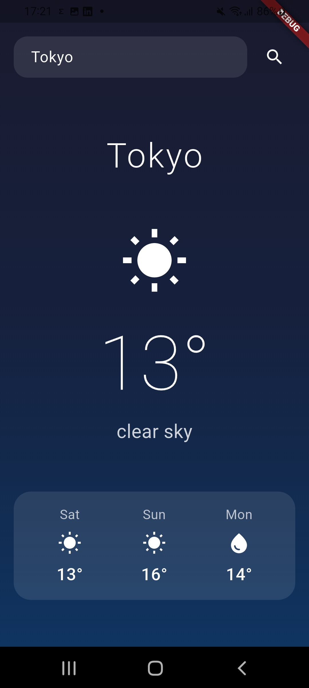

# 🌤️ Flutter Weather App

A clean, iOS-inspired weather app built with Flutter as a pet project for learning Dart, Flutter and app architecture.



## Features

- Search weather by city name
- Current temperature and weather condition
- 3-day forecast with weather icons
- Gradient UI inspired by the iOS Weather app
- Readable error messages for empty input, unknown cities, API errors, timeouts and network problems

## Tech Stack

| Area | Tool |
|---|---|
| UI framework | Flutter (Material) |
| Language | Dart 3 |
| State management | **flutter_bloc** (BLoC pattern) |
| Networking | http |
| JSON parsing | json_serializable + json_annotation (code generation via build_runner) |
| Local storage | shared_preferences (for search history, in progress) |
| Static analysis | flutter_lints |
| Data source | OpenWeatherMap 5-day / 3-hour forecast API |

## Architecture

The app is split into layers, and each layer only talks to the one below it:

```
UI (WeatherPage)
   │  sends events, rebuilds on states (BlocBuilder)
   ▼
WeatherBloc
   │  calls the repository, maps the result to a state
   ▼
WeatherRepository
   │  HTTP request, status and timeout checks, JSON parsing
   ▼
OpenWeatherMap API
```

```
lib/
├── main.dart                     # app entry point, provides WeatherBloc via BlocProvider
├── weather_page.dart             # UI: search bar, current weather, forecast list
├── bloc/
│   ├── weather_bloc.dart         # handles events, emits states
│   ├── weather_event.dart        # FetchWeatherEvent
│   └── weather_state.dart        # Initial / Loading / Loaded / Error
└── data/
    ├── weather_repository.dart       # API requests
    ├── search_history_repository.dart# local search history (in progress)
    ├── weather_exception.dart        # app-level error with a user-facing message
    └── models/
        ├── weather_response.dart     # json_serializable models of the API response
        ├── weather_item.dart
        ├── weather_main.dart
        ├── weather_condition.dart
        ├── weather_city.dart
        └── weather_display_model.dart# API data transformed for the UI
```

**Data flow:** the user enters a city → the UI adds `FetchWeatherEvent` → `WeatherBloc` emits `WeatherLoading`, asks `WeatherRepository` for data → on success it emits `WeatherLoaded` with a `WeatherDisplayModel`, on failure `WeatherError` with a message → `BlocBuilder` redraws the screen for the current state.

**Error handling:** the repository throws `WeatherException` with a message meant for the user (empty input, non-200 response, 10-second timeout). The BLoC catches it and shows that message; any other exception becomes a generic "check your internet connection" message, so raw exceptions never reach the screen.

**Display model:** `WeatherDisplayModel` takes the raw 3-hour forecast list, picks the current reading and one entry per following day, so the UI gets ready-to-show data and contains no parsing logic.

## Migration from Provider to BLoC

State management in this project went through three stages, and the commit history shows each of them:

1. **`setState` inside the widget.** Network calls, parsing and UI lived in one place.
2. **`ChangeNotifier` + Provider.** The state moved into a separate `WeatherState` class, and the UI only subscribed to its changes. This was the first separation of concerns.
3. **BLoC (`flutter_bloc`).** The current version.

Why BLoC: with `ChangeNotifier` the state was one class with several mutable fields (`isLoading`, `error`, `data`), so impossible combinations such as "loading and error at the same time" were possible. With BLoC:

- every screen state is its own class (`WeatherInitial`, `WeatherLoading`, `WeatherLoaded`, `WeatherError`), and the UI simply reacts to which one it got;
- the UI does not call methods directly, it sends events, so the flow "event → bloc → state" is explicit;
- business logic is easier to test in isolation from widgets.

What changed during the migration:

- `ChangeNotifierProvider` in `main.dart` was replaced with `BlocProvider`, which creates `WeatherBloc` with an injected `WeatherRepository`;
- `WeatherPage` was rewritten on `BlocBuilder`, and every remaining reference to Provider was removed;
- the old `WeatherState` (`ChangeNotifier`) class was deleted;
- a bug found along the way was fixed: the forecast list showed the current weather instead of the next days.

## Development Practices

- **Layered architecture** — UI, state and data are kept apart; the repository is passed into the BLoC through its constructor.
- **Generated code is not committed** — `*.g.dart` files are in `.gitignore` and are regenerated with `build_runner`.
- **API key is kept out of git** — it lives in `lib/local.dart`, which is ignored.
- **Linting** — `flutter_lints` with the platform folders excluded from analysis.
- **Small, descriptive commits**, recently in the Conventional Commits style (`feat:`, `fix:`, `docs:`).

## Getting Started

1. Clone the repository
   ```bash
   git clone https://github.com/Twistercd/flutter_weather_app.git
   ```

2. Get dependencies
   ```bash
   flutter pub get
   ```

3. Generate JSON model code
   ```bash
   dart run build_runner build --delete-conflicting-outputs
   ```

4. Create `lib/local.dart` with your API key
   ```dart
   const String openWeatherApiKey = 'YOUR_API_KEY';
   ```
   Get a free key at [openweathermap.org](https://openweathermap.org/api).

5. Run the app
   ```bash
   flutter run
   ```

## What's Next

- [ ] Search history: show the last few searched cities (shared_preferences, in progress)
- [ ] Unit tests for `WeatherBloc` and `WeatherRepository` (bloc_test, mocktail)
- [ ] Geolocation support
- [ ] Dark/light theme toggle
